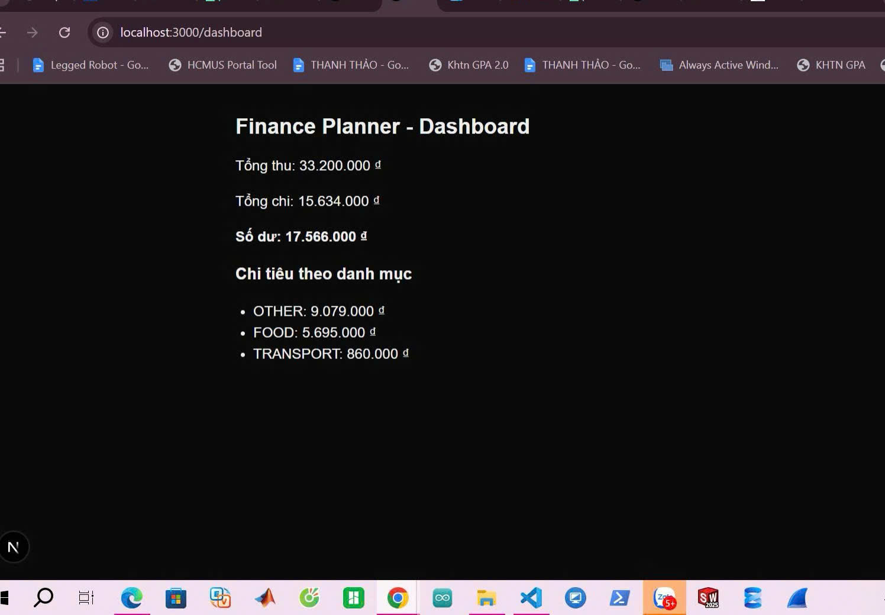
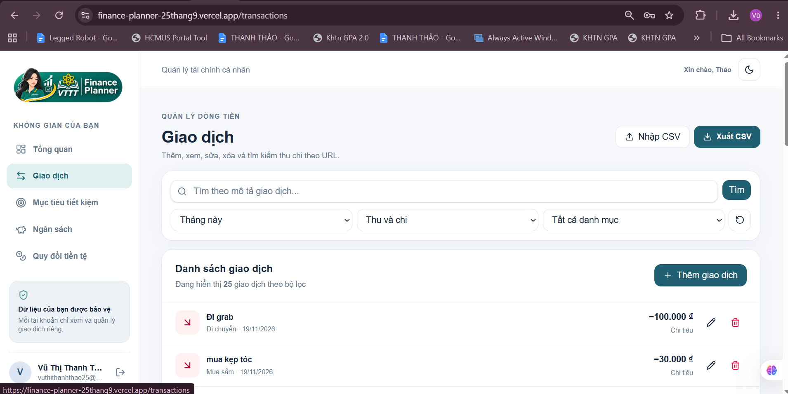

# AI_LOG – Nhật ký sử dụng AI

**Dự án:** Finance Planner – Đồ án cá nhân PHY10615  
**Công cụ AI:** ChatGPT  
**Repository:** https://github.com/25thang9/finance-planner

## 1. Quá trình thực hiện ban đầu

Dự án được bắt đầu từ các bài thực hành Tuần 8–10 trên WebLab, gồm thiết lập Next.js, Prisma, PostgreSQL Neon và các chức năng quản lý tài chính cơ bản. Ứng dụng đã được chạy thử trên localhost trước khi tiếp tục hoàn thiện với sự hỗ trợ của ChatGPT.

**Minh chứng thực hành trên local:**

## 2. Nhật ký sử dụng AI

| Ngày | Công cụ | Việc nhờ AI | Prompt (tóm tắt) | Kết quả dùng thế nào | Mình đã kiểm chứng / sửa gì | Commit/PR |
|---|---|---|---|---|---|---|
| 17–18/11/2026 | ChatGPT | Hoàn thiện chức năng cốt lõi | Hỗ trợ xác thực, CRUD giao dịch, Wishlist, Dashboard, lọc URL và thông báo tiết kiệm | Tích hợp và điều chỉnh mã nguồn | Kiểm tra chức năng, dữ liệu và giao diện trên localhost | `7a806a8` |
| 18/11/2026 | ChatGPT | Bổ sung tính năng mở rộng | Hỗ trợ ngân sách theo danh mục, cảnh báo 80%/100% và biểu đồ so sánh thu chi các tháng | Tích hợp vào trang Ngân sách và Dashboard | Kiểm tra kết quả hiển thị trên local | `7a806a8` |
| 19/11/2026 | ChatGPT | Cải thiện giao diện | Thiết kế logo VTTT, điều chỉnh Login, Sidebar và Light/Dark Mode | Cập nhật component và CSS | Kiểm tra bố cục, màu sắc và TypeScript | `3214a6d` |
| 19–21/11/2026 | ChatGPT | Chuẩn hóa tài liệu | Đối chiếu README, AI_LOG và AGENTS với mẫu PHY10615 | Cập nhật tài liệu và minh chứng thực hành | Kiểm tra yêu cầu đề bài và lịch sử Git | `5a14b35`, `2f999a0`, `7e3e63e` |
| 20–21/11/2026 | ChatGPT | Nhập/Xuất CSV | Xây dựng API, kiểm tra CSV bằng Zod, tải file mẫu và xuất theo bộ lọc | Tích hợp Route Handler và giao diện trang Giao dịch | Sửa import sai `@/lib/dal` thành `@/lib/session`; kiểm tra trên localhost | `1ddc554` |
| 21/11/2026 | ChatGPT | Kiểm thử CSV | Viết 13 test cho dữ liệu hợp lệ và không hợp lệ | Bổ sung `csv-import.test.ts` | Chạy Vitest: 39/39 test PASS | `1ddc554` |
| 23/11/2026 | ChatGPT | Mục tiêu tiết kiệm có hạn chót | Bổ sung hạn chót, số tháng còn lại và gợi ý tiết kiệm hằng tháng | Cập nhật Prisma, Wishlist, Server Action và logic tính toán | Tạo lại Prisma Client, kiểm tra chức năng trên localhost | `4f957ab` |
| 23/11/2026 | ChatGPT | Kiểm thử và xử lý lỗi | Viết 8 test tiết kiệm, kiểm tra TypeScript, ESLint và build | Bổ sung `savings-plan.test.ts`, sửa lỗi purity trong `page.tsx` | 47/47 test PASS; typecheck PASS; ESLint 0 lỗi, 4 cảnh báo; CI GitHub 2/2 PASS | `4f957ab` |

## 3. Kết quả kiểm thử

Ngày 23/11/2026, kết quả kiểm thử phiên bản mới nhất:

- **47/47 test PASS** trên 5 file, gồm 46 Unit Test và 1 Component Test.
- TypeScript typecheck: PASS.
- Production Build: PASS ở lần kiểm tra đã ghi nhận.
- ESLint: 0 lỗi, 4 cảnh báo.
- GitHub Actions: 2/2 checks PASS.

## Tự đánh giá cuối bài

**Phần mình tự làm hoàn toàn:**

Thực hành các nội dung ban đầu trên WebLab, cấu hình môi trường, chạy thử ứng dụng, kiểm tra chức năng trên localhost và thực hiện các thao tác Commit, Push.

**Phần AI giúp nhiều nhất và mình đã hiểu nó thế nào:**

ChatGPT hỗ trợ nhiều trong việc phát triển chức năng, chỉnh sửa giao diện, xử lý lỗi và viết kiểm thử. Các nội dung được tìm hiểu gồm Zod kiểm tra dữ liệu, Prisma và Neon lưu trữ, session và `userId` bảo vệ dữ liệu, Vitest kiểm thử tự động. 

**Một lần AI sai và cách mình phát hiện:**

Khi phát triển chức năng Xuất CSV, AI đề xuất sử dụng `@/lib/dal` không tồn tại trong dự án. Lỗi được phát hiện qua TypeScript và build, sau đó sửa theo cơ chế xác thực thực tế tại `@/lib/session`. Khi thêm trường `deadline` cho Wishlist, Prisma Client chưa cập nhật nên phát sinh lỗi TypeScript; vấn đề được xử lý bằng migration và tạo lại Prisma Client.

---

**Tài liệu thực hành:** https://weblab.koomaru.com/  
**Repository:** https://github.com/25thang9/finance-planner