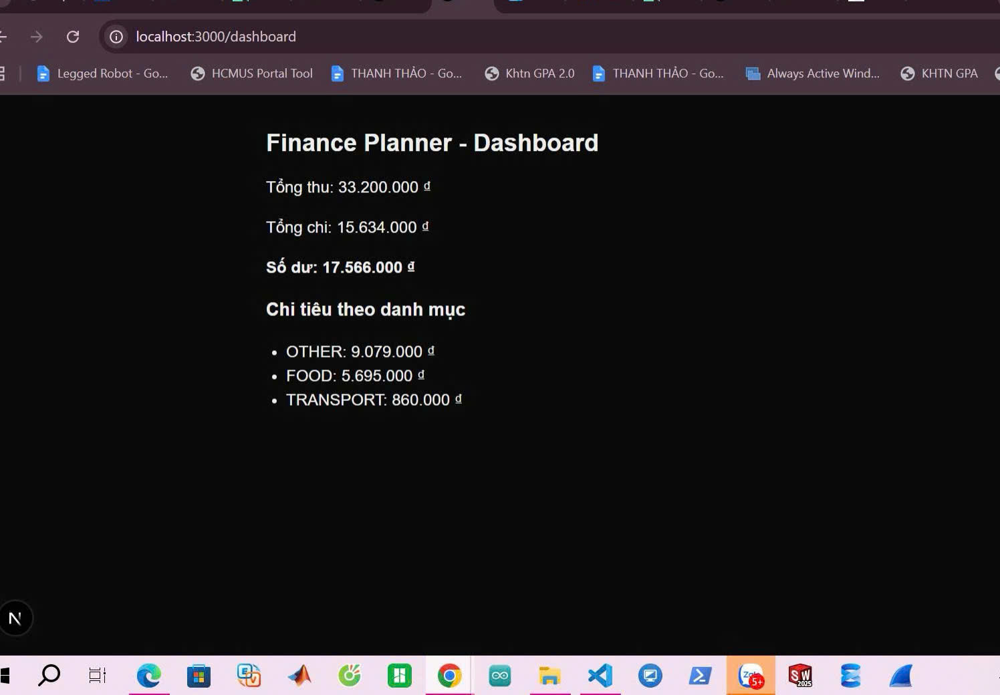
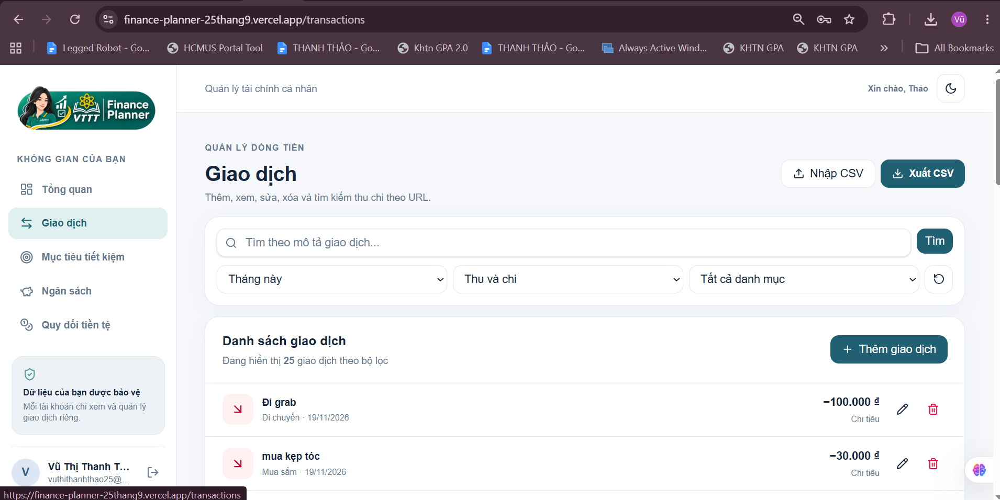

# Finance Planner

**Đồ án cá nhân – PHY10615 | HK1 2026–2027**

Finance Planner là ứng dụng web quản lý tài chính cá nhân, hỗ trợ theo dõi thu nhập, chi tiêu, quản lý ngân sách và mục tiêu tiết kiệm. Ứng dụng cung cấp Dashboard trực quan, biểu đồ thống kê và các công cụ quản lý giao dịch.

Hệ thống được phát triển bằng Next.js, TypeScript, Prisma ORM và PostgreSQL Neon, với giao diện tiếng Việt, hỗ trợ responsive và chế độ sáng/tối.

## 1. Thông tin dự án

- **GitHub:** https://github.com/25thang9/finance-planner
- **Website Production:** https://finance-planner-25thang9.vercel.app
- **Mức sử dụng AI:** Mức 3 – AI cộng tác
- **Nhật ký sử dụng AI:** [AI_LOG.md](./AI_LOG.md)

**Tài khoản demo dành cho giảng viên**

- Email: [Bổ sung tài khoản demo khi nộp]
- Mật khẩu: [Bổ sung mật khẩu demo khi nộp]

## 2. Công nghệ sử dụng

| Thành phần | Công nghệ |
|---|---|
| Frontend | Next.js 16.4, React 19, TypeScript |
| Giao diện | Tailwind CSS 4, shadcn/ui, next-themes |
| Backend | Next.js App Router, Server Actions, Route Handlers |
| Cơ sở dữ liệu | PostgreSQL Neon |
| ORM | Prisma ORM 7 |
| Xác thực | Better Auth |
| Kiểm tra dữ liệu | Zod 4 |
| Biểu đồ và thông báo | Recharts, Sonner |
| Xử lý CSV | csv-parse |
| Kiểm thử | Vitest, React Testing Library |
| Triển khai | GitHub Actions, Vercel |

## 3. Checklist tính năng

### 3.1. Tính năng cốt lõi

- [ ] Đăng ký, đăng nhập và đăng xuất.
- [ ] Đăng nhập bằng GitHub OAuth.
- [ ] Bảo vệ dữ liệu theo tài khoản người dùng.
- [ ] Thêm, xem, sửa và xóa giao dịch.
- [ ] Kiểm tra dữ liệu giao dịch bằng Zod.
- [ ] Lọc giao dịch theo thời gian, loại và danh mục.
- [ ] Tìm kiếm giao dịch và lưu bộ lọc trên URL.
- [ ] Dashboard hiển thị tổng thu, tổng chi và số dư.
- [ ] Biểu đồ thống kê chi tiêu theo danh mục.
- [ ] Quản lý mục tiêu tiết kiệm (Wishlist).
- [ ] Hiển thị tiến độ tiết kiệm.
- [ ] Thông báo khi đạt các mốc tiết kiệm.
- [ ] Giao diện responsive và hỗ trợ Light/Dark Mode.

### 3.2. Tính năng mở rộng

- [ ] Quản lý ngân sách theo danh mục hằng tháng.
- [ ] Cảnh báo khi ngân sách đạt 80% và 100%.
- [ ] Nhập giao dịch từ file CSV.
- [ ] Xuất giao dịch thành CSV theo bộ lọc.
- [ ] Kiểm tra định dạng và dữ liệu CSV bằng Zod.
- [ ] Tải file CSV mẫu và kiểm tra trước khi nhập.

### 3.3. Kiểm thử và triển khai

- [ ] Có tối thiểu 8 unit test.
- [ ] Có tối thiểu 1 component test.
- [ ] Unit test chức năng Nhập CSV hoạt động.
- [ ] Lint không có lỗi.
- [ ] TypeScript typecheck thành công.
- [ ] Production build thành công.
- [ ] GitHub Actions CI thành công.
- [ ] Website hoạt động trên Vercel Production.
- [ ] Tài khoản demo đăng nhập và sử dụng được.

Các mục được đánh dấu sau khi hoàn tất kiểm tra chức năng và xác nhận kết quả.

## 4. Tính năng mở rộng – Nhập/Xuất CSV

Chức năng Nhập/Xuất CSV được bổ sung nhằm hỗ trợ quản lý nhiều giao dịch và sao lưu dữ liệu dưới dạng bảng.

### 4.1. Nhập CSV

**Route Handler:** `POST /api/transactions/import`

Người dùng có thể tải file CSV mẫu, điền dữ liệu và tải lên hệ thống. Trước khi nhập, dữ liệu được kiểm tra phía server bằng Zod.

Các điều kiện kiểm tra gồm:

- File CSV sử dụng mã hóa UTF-8.
- Dung lượng tối đa 2 MB.
- Tối đa 500 giao dịch mỗi lần nhập.
- Ngày theo định dạng `YYYY-MM-DD`.
- Loại giao dịch là `INCOME` hoặc `EXPENSE`.
- Số tiền là số nguyên dương.
- Danh mục thuộc các giá trị hợp lệ của hệ thống.
- Mô tả không được để trống.

Nếu dữ liệu không hợp lệ, hệ thống trả về thông báo lỗi và không thực hiện thao tác lưu giao dịch.

### 4.2. Xuất CSV

**Route Handler:** `GET /api/transactions/export`

Chức năng cho phép xuất danh sách giao dịch ra file CSV theo bộ lọc đang áp dụng. Dữ liệu xuất thuộc tài khoản đăng nhập và được mã hóa UTF-8 để hỗ trợ hiển thị tiếng Việt trong Excel.

Các thao tác nhập và xuất sử dụng Route Handler của Next.js kết hợp với Prisma để truy vấn và lưu dữ liệu trên Neon.

## 5. Hướng dẫn chạy local

**Yêu cầu:** Node.js 24, npm và PostgreSQL Neon.

**Lấy mã nguồn:**

```powershell
git clone https://github.com/25thang9/finance-planner.git
cd finance-planner
```

**Cài đặt thư viện:**

```powershell
npm.cmd ci
```

**Cấu hình môi trường:**

Tạo file `.env` từ `.env.example` và cấu hình các biến liên quan đến kết nối Neon, Better Auth và GitHub OAuth.

File `.env` và các thông tin bí mật không được đưa lên GitHub.

**Khởi tạo Prisma:**

```powershell
npx.cmd prisma generate
npx.cmd prisma migrate status
```

Trên cơ sở dữ liệu phát triển mới, có thể thực hiện migration và seed theo cấu hình dự án:

```powershell
npx.cmd prisma migrate dev
npx.cmd prisma db seed
```

Các thao tác thay đổi cơ sở dữ liệu không được thực hiện tùy tiện trên Production có dữ liệu cần bảo toàn.

**Chạy ứng dụng:**

```powershell
npm.cmd run dev
```

Địa chỉ local: http://localhost:3000

## 6. Kiểm thử

Dự án sử dụng Vitest và React Testing Library để kiểm tra logic nghiệp vụ, dữ liệu đầu vào và component giao diện.

**Các lệnh kiểm tra:**

```powershell
npm.cmd run lint
npm.cmd run typecheck
npx.cmd vitest run
npm.cmd run build
```

**Kết quả Vitest ngày 21/11/2026:**

| File | Số test | Kết quả |
|---|---:|---|
| `finance.test.ts` | 16 | PASS |
| `validation.test.ts` | 9 | PASS |
| `csv-import.test.ts` | 13 | PASS |
| `empty-state.test.tsx` | 1 | PASS |
| **Tổng** | **39** | **39/39 PASS** |

Bộ kiểm thử gồm 38 unit test và 1 component test. Kết quả được ghi nhận khi chạy `npx.cmd vitest run` trên môi trường local.

GitHub Actions được sử dụng để kiểm tra tự động mã nguồn. Trạng thái CI, lint, typecheck và production build của phiên bản cuối cùng cần được xác nhận trước khi nộp.

Kiểm thử E2E bằng Playwright chưa được triển khai; đây là nội dung khuyến khích trong đề bài.

## 7. Minh chứng thực hành

Các ảnh dưới đây ghi nhận quá trình thực hành và chạy thử Finance Planner trên localhost trong giai đoạn đầu của đồ án.

### 7.1. Dashboard



### 7.2. Quản lý giao dịch



Ảnh giao diện của phiên bản hoàn chỉnh sẽ được bổ sung sau khi kết thúc phát triển và kiểm tra bản Production.

## 8. Quyết định kỹ thuật

- **Lưu tiền VND bằng `Int`:** Đảm bảo số tiền được xử lý dưới dạng số nguyên.
- **Zod:** Kiểm tra dữ liệu đầu vào phía server trước các thao tác ghi.
- **Session và `userId`:** Xác định tài khoản đăng nhập và giới hạn quyền truy cập dữ liệu.
- **URL `searchParams`:** Lưu trạng thái lọc và tìm kiếm trên URL.
- **Server Actions:** Xử lý các thao tác thêm, sửa và xóa dữ liệu.
- **Route Handlers:** Cung cấp API giao dịch và xử lý nhập/xuất CSV.
- **Tách logic CSV:** Đặt phần kiểm tra dữ liệu trong `lib/csv-import.ts` để tái sử dụng và kiểm thử độc lập.
- **Component dùng chung:** Tái sử dụng các thành phần giao diện nhằm đảm bảo tính nhất quán và hỗ trợ chế độ sáng/tối.

## 9. Giới hạn hiện tại

- Ứng dụng cần kết nối với PostgreSQL Neon để sử dụng các chức năng liên quan đến dữ liệu.
- GitHub OAuth phụ thuộc vào cấu hình xác thực của môi trường triển khai.
- Chưa tích hợp kiểm thử E2E bằng Playwright.
- Chưa hỗ trợ thông báo tiết kiệm qua email hoặc push notification.
- Nhập CSV chưa tự phát hiện giao dịch trùng khi cùng một file được nhập nhiều lần.
- Giới hạn độ dài mô tả trong CSV cần được đồng bộ với quy định của chức năng CRUD.
- Kết quả CI và khả năng hoạt động của phiên bản Production cuối cùng cần được kiểm tra trước khi nộp.

## 10. Tài liệu liên quan

Dự án được phát triển từ các bài thực hành Tuần 8–10 trên [WebLab](https://weblab.koomaru.com/) và tiếp tục được hoàn thiện với sự hỗ trợ của ChatGPT.

- [AI_LOG.md](./AI_LOG.md) – Nhật ký sử dụng AI và quá trình kiểm chứng.
- [AGENTS.md](./AGENTS.md) – Quy tắc kỹ thuật của dự án.

**Commit tính năng Nhập/Xuất CSV:** `1ddc554` – 21/11/2026.

---

**Finance Planner – PHY10615 | HK1 2026–2027**