# Finance Planner – Ứng dụng quản lý tài chính cá nhân

**Đồ án cá nhân môn Phát triển ứng dụng web (PHY10615)**  
**Học kỳ:** HK1, năm học 2026–2027  
**Hình thức:** Đồ án cá nhân  
**Mức AI theo quy định của đồ án cá nhân:** Mức 3 – AI cộng tác  
**Mức độ AI sử dụng thực tế (tự khai báo):** Tương đương Mức 4 – AI toàn phần có kiểm soát (xem [AI_LOG.md](./AI_LOG.md))

**Các thành phần trong hồ sơ nộp:** mã nguồn public, website Vercel Production, tài khoản demo, README, AI_LOG và AGENTS. Bản README này trình bày như báo cáo kỹ thuật ngắn của đồ án cá nhân; không thay cho một báo cáo PDF riêng.

## 1. Giới thiệu

Finance Planner là ứng dụng web hỗ trợ quản lý tài chính cá nhân thông qua việc ghi nhận thu nhập, chi tiêu và theo dõi số dư. Hệ thống cung cấp biểu đồ thống kê, bộ lọc giao dịch, quản lý ngân sách và mục tiêu tiết kiệm nhằm giúp người dùng theo dõi tình hình tài chính theo thời gian. Ngoài các chức năng cốt lõi, dự án triển khai nhập/xuất CSV, gợi ý kế hoạch tiết kiệm và quy đổi USD/EUR sang VND theo tỷ giá tham khảo từ dịch vụ bên ngoài.

Giao diện ứng dụng sử dụng tiếng Việt, hỗ trợ máy tính và thiết bị di động, có chế độ sáng/tối. Dữ liệu nghiệp vụ được lưu trên PostgreSQL (Neon) và gắn với tài khoản đăng nhập.

Phần nền tảng của dự án được thực hành theo các bài học WebLab Tuần 8–10. Các chức năng được tiếp tục hoàn thiện và mở rộng với sự hỗ trợ của ChatGPT; quá trình sử dụng AI, cách tích hợp và kiểm chứng được ghi cụ thể trong [AI_LOG.md](./AI_LOG.md).

### 1.1. Thông tin triển khai

| Nội dung | Đường dẫn / thông tin |
|---|---|
| Repository GitHub | [25thang9/finance-planner](https://github.com/25thang9/finance-planner) |
| Website Production | [finance-planner-25thang9.vercel.app](https://finance-planner-25thang9.vercel.app) |
| Nhật ký sử dụng AI | [AI_LOG.md](./AI_LOG.md) |
| Quy tắc dự án | [AGENTS.md](./AGENTS.md) |
| Nền tảng triển khai | Vercel |

### 1.2. Tài khoản demo cho giảng viên

| Thông tin | Giá trị |
|---|---|
| Địa chỉ đăng nhập | [Trang đăng nhập Production](https://finance-planner-25thang9.vercel.app/login) |
| Email demo | **`vuthithanhthao25@gmail.com`** |
| Mật khẩu demo | **`1234567890`** |

Tài khoản demo phục vụ đánh giá học phần, sử dụng dữ liệu giả lập để minh họa các luồng giao dịch và mục tiêu tiết kiệm. Giảng viên có thể đăng nhập trên website Production để thao tác và kiểm thử các chức năng. Mật khẩu demo được sử dụng riêng cho đồ án học tập; dữ liệu trong tài khoản là dữ liệu minh họa, không phải dữ liệu tài chính thực tế.

## 2. Công nghệ và kiến trúc

### 2.1. Công nghệ sử dụng

| Thành phần | Công nghệ / phiên bản |
|---|---|
| Nền tảng full-stack | Next.js 16.4.6 (App Router), React 19, TypeScript |
| Giao diện | Tailwind CSS v4, shadcn/ui (Radix UI), Lucide Icons |
| Chủ đề sáng/tối | `next-themes` |
| Cơ sở dữ liệu | PostgreSQL – Neon |
| ORM | Prisma ORM 7.10.1, `@prisma/adapter-pg` |
| Xác thực | Better Auth 1.7, email/mật khẩu và GitHub OAuth |
| Kiểm tra dữ liệu | Zod 4 |
| Biểu đồ | Recharts |
| Thông báo | Sonner |
| Xử lý CSV | `csv-parse`, Next.js Route Handlers |
| Quy đổi ngoại tệ | ExchangeRate-API (`open.er-api.com`) |
| Kiểm thử | Vitest 5, React Testing Library |
| Tích hợp và triển khai | GitHub Actions, Vercel |
| Môi trường phát triển | Node.js 24, npm |

### 2.2. Tổ chức ứng dụng

Dự án sử dụng **Next.js App Router** và được tổ chức theo trách nhiệm của từng thành phần. `app/(app)/` chứa các trang sau đăng nhập và layout bảo vệ phiên; `app/api/` cung cấp Route Handlers cho xác thực, giao dịch, CSV và tỷ giá. `components/` chứa thành phần giao diện dùng chung; `lib/` tập trung logic nghiệp vụ, kiểm tra dữ liệu và kết nối cơ sở dữ liệu. `prisma/` quản lý schema, migration và seed dữ liệu mẫu.

Cấu trúc dưới đây **liệt kê các thư mục và tệp tiêu biểu**, không phải toàn bộ tệp mã nguồn:

```text
finance-planner/
├── app/
│   ├── (app)/
│   │   ├── dashboard/            # Tổng quan, biểu đồ
│   │   ├── transactions/         # CRUD và bộ lọc giao dịch
│   │   ├── wishlist/             # Mục tiêu tiết kiệm
│   │   ├── budgets/              # Ngân sách
│   │   ├── currency/             # Quy đổi USD/EUR → VND
│   │   └── layout.tsx            # Yêu cầu phiên đăng nhập
│   ├── api/
│   │   ├── auth/[...all]/route.ts # Better Auth
│   │   ├── transactions/
│   │   │   ├── route.ts          # API danh sách giao dịch
│   │   │   ├── import/route.ts   # Nhập CSV
│   │   │   └── export/route.ts   # Xuất CSV
│   │   └── exchange-rates/route.ts
│   ├── login/                    # Đăng nhập
│   ├── register/                 # Đăng ký
│   ├── layout.tsx                # Layout gốc
│   ├── globals.css               # CSS toàn ứng dụng
│   └── icon.png                  # Favicon VTTT
├── components/
│   ├── ui/                       # Thành phần giao diện cơ bản
│   ├── app-shell.tsx             # Điều hướng và bố cục
│   └── charts.tsx                # Biểu đồ
├── lib/
│   ├── auth.ts                   # Cấu hình Better Auth
│   ├── session.ts                # Xác thực phiên người dùng
│   ├── prisma.ts                 # Prisma Client
│   ├── finance.ts                # Tính toán nghiệp vụ
│   ├── validation.ts             # Schema Zod
│   ├── csv-import.ts             # Đọc và kiểm tra CSV
│   ├── csv-export.ts             # Xuất CSV
│   └── exchange-rate.ts          # Truy xuất và quy đổi tỷ giá
├── prisma/
│   ├── migrations/               # Lịch sử migration
│   ├── schema.prisma             # Các model dữ liệu
│   ├── seed.ts                   # Seed dữ liệu
│   └── seed-data.ts              # Bộ dữ liệu mẫu
├── __tests__/                    # Unit và component tests
├── public/                       # Tài nguyên tĩnh
├── docs/images/                  # Ảnh minh chứng trong README
├── .github/workflows/ci.yml     # GitHub Actions
├── .env.example                  # Mẫu biến môi trường
├── prisma.config.ts             # Cấu hình Prisma 7
├── vitest.config.mts             # Cấu hình kiểm thử
├── next.config.ts                # Cấu hình Next.js
├── package.json                  # Phụ thuộc và npm scripts
├── AI_LOG.md                     # Nhật ký sử dụng AI
├── AGENTS.md                     # Quy tắc dự án
└── README.md                     # Tài liệu đồ án
```

Những thư mục sinh tự động như `node_modules/`, `.next/` và `generated/` không được đưa vào Git. Prisma Client được sinh bằng lệnh `prisma generate`; vì vậy việc không có thư mục `generated/` trong repository là phù hợp với cấu hình hiện tại.

### 2.3. Luồng xử lý dữ liệu

1. Người dùng đăng nhập qua Better Auth để tạo phiên làm việc.
2. Trang hoặc Server Action xác định người dùng từ phiên đăng nhập và thực hiện kiểm tra quyền truy cập đối với dữ liệu cá nhân.
3. Dữ liệu nhập được kiểm tra bằng Zod trước khi ghi vào cơ sở dữ liệu.
4. Prisma truy vấn PostgreSQL trên Neon; các dữ liệu thuộc người dùng được giới hạn theo `userId`.
5. Dashboard và các trang chức năng hiển thị kết quả bằng thành phần giao diện và biểu đồ tương ứng.

## 3. Danh sách chức năng theo yêu cầu đề bài

Ký hiệu **✅** thể hiện chức năng đã triển khai và được kiểm tra trong quá trình phát triển; **❌** thể hiện nội dung chưa triển khai (nếu có). Kết quả kiểm thử tự động được trình bày tại Mục 7.

### 3.1. Tính năng cốt lõi

- ✅ Đăng ký, đăng nhập bằng email và mật khẩu; hiển thị thông tin tài khoản và đăng xuất.
- ✅ Đăng nhập bằng GitHub OAuth thông qua Better Auth.
- ✅ Giới hạn dữ liệu giao dịch, wishlist và ngân sách theo người dùng đăng nhập tại các chức năng đã kiểm tra.
- ✅ Quản lý giao dịch: thêm, xem, sửa và xóa.
- ✅ Giao dịch có số tiền VND nguyên dương, mô tả, loại thu/chi, danh mục và ngày giao dịch.
- ✅ Kiểm tra dữ liệu đầu vào phía server bằng Zod và hiển thị thông báo kết quả thao tác.
- ✅ Lọc giao dịch theo tháng này, tháng trước hoặc tất cả; lọc theo loại và danh mục.
- ✅ Tìm kiếm theo mô tả và giữ trạng thái bộ lọc trên URL (`searchParams`).
- ✅ Dashboard hiển thị tổng thu nhập, tổng chi tiêu và số dư hiện tại.
- ✅ Biểu đồ tròn chi tiêu theo danh mục, có bảng số liệu thay thế cho trình đọc màn hình.
- ✅ Quản lý wishlist: thêm, xem, sửa, xóa; tên, giá và độ ưu tiên.
- ✅ Hiển thị tiến độ từng mục tiêu theo số dư/giá mục tiêu, giới hạn 0–100%.
- ✅ Thông báo động viên khi đạt các mốc 50%, 75% và 100%, không thông báo lặp lại mốc đã ghi nhận.
- ✅ Giao diện tiếng Việt, hỗ trợ thiết bị di động và chế độ sáng/tối.
- ✅ Biểu mẫu có nhãn, thao tác bàn phím cơ bản và trạng thái focus hiển thị rõ; giao diện được kiểm tra trên màn hình nhỏ.

### 3.2. Tính năng mở rộng

- ✅ **Ngân sách theo danh mục/tháng:** theo dõi mức sử dụng và cảnh báo tại ngưỡng 80% và 100%.
- ✅ **Nhập/xuất CSV:** nhập dữ liệu có kiểm tra định dạng; xuất giao dịch theo bộ lọc; có tệp mẫu.
- ✅ **Mục tiêu tiết kiệm có hạn chót:** tính số tháng còn lại và gợi ý số tiền cần tiết kiệm mỗi tháng.
- ✅ **Báo cáo thu/chi sáu tháng:** biểu đồ so sánh xu hướng theo tháng.
- ✅ **Đa tiền tệ USD/EUR → VND:** lấy tỷ giá từ `open.er-api.com`, cache một giờ và hiển thị nguồn cùng thời điểm cập nhật.

Các lựa chọn mở rộng trên đáp ứng yêu cầu **tối thiểu một tính năng mở rộng** của đồ án cá nhân.

- ❌ Giao dịch định kỳ tự động: không triển khai.
- ❌ PWA cài đặt trên điện thoại: không triển khai.
- ❌ Phân loại giao dịch bằng Gemini API: không triển khai.

Đây là các lựa chọn mở rộng tùy chọn trong đề, không phải chức năng cốt lõi còn thiếu.

## 4. Mô tả các chức năng tiêu biểu

### 4.1. Quản lý giao dịch và bộ lọc

Người dùng tạo, cập nhật hoặc xóa các khoản thu/chi. Danh mục bao gồm Ăn uống, Di chuyển, Giải trí, Mua sắm, Hóa đơn, Lương, Đầu tư và Khác. Các bộ lọc được xử lý phía server và biểu diễn trên URL để có thể giữ lại trạng thái tìm kiếm.

Endpoint `GET /api/transactions` trả dữ liệu giao dịch thuộc phiên đăng nhập; trường hợp chưa đăng nhập trả mã **401**, tham số lọc không hợp lệ trả **400**.

### 4.2. Wishlist và mốc tiết kiệm

Tiến độ mỗi mục tiêu được xác định từ **số dư hiện tại ÷ giá mục tiêu × 100%**, giới hạn trong khoảng 0–100%; số dư âm được tính là 0%. Các giá trị tiến độ dưới 1% được hiển thị với hai chữ số thập phân theo định dạng Việt Nam. Tiến độ dựa trên số dư chung, chưa phân bổ tiền vào từng mục tiêu riêng biệt.

Thông báo chúc mừng được kích hoạt khi số dư đạt các mốc 50%, 75% và 100%; trạng thái mốc đã thông báo được lưu để tránh lặp. Đối với mục tiêu có hạn chót, ứng dụng ước tính số tiền cần tiết kiệm theo từng tháng dựa trên số tiền còn thiếu và thời gian còn lại.

### 4.3. Ngân sách và báo cáo

Người dùng lập ngân sách theo danh mục trong tháng. Ứng dụng đối chiếu tổng chi với hạn mức và đưa ra cảnh báo khi đạt ngưỡng. Dashboard thể hiện tổng quan số dư, cơ cấu chi tiêu, giao dịch gần đây và xu hướng thu/chi trong sáu tháng.

### 4.4. Nhập và xuất CSV

| Chức năng | Đường dẫn API | Nội dung |
|---|---|---|
| Nhập CSV | `POST /api/transactions/import` | Kiểm tra định dạng và dữ liệu trước khi ghi |
| Xuất CSV | `GET /api/transactions/export` | Xuất giao dịch theo bộ lọc và phạm vi tài khoản |

Tệp nhập sử dụng UTF-8, ngày theo dạng `YYYY-MM-DD`, loại `INCOME`/`EXPENSE`, số tiền nguyên dương và danh mục hợp lệ. Giới hạn được áp dụng trong chức năng nhập: **2 MB và 500 giao dịch mỗi lần**. Dữ liệu không hợp lệ được từ chối thay vì ghi một phần không kiểm soát.

### 4.5. Quy đổi tiền tệ USD/EUR sang VND

Trang `/currency` cho phép chọn USD hoặc EUR, nhập số tiền không âm và xem giá trị quy đổi sang VND. Tỷ giá được truy xuất từ ExchangeRate-API thông qua Route Handler nội bộ.

| Thành phần | Chi tiết |
|---|---|
| API nội bộ | `GET /api/exchange-rates?currency=USD` hoặc `currency=EUR` |
| Dữ liệu nguồn | `https://open.er-api.com/v6/latest/USD` và `https://open.er-api.com/v6/latest/EUR` |
| Bộ nhớ đệm | Next.js Data Cache với `revalidate: 3600` (3.600 giây) |
| Xử lý dữ liệu | Kiểm tra mã tiền tệ, tỷ giá hợp lệ, số tiền không âm và lỗi nguồn API |
| Thông tin hiển thị | Số tiền VND, tỷ giá áp dụng, thời điểm cập nhật dữ liệu gốc, liên kết nguồn |
| Nguồn ghi nhận | [ExchangeRate-API](https://www.exchangerate-api.com/) |

Tỷ giá chỉ mang tính tham khảo và không đại diện cho tỷ giá mua/bán thực tế của ngân hàng. **Cache một giờ là chu kỳ làm mới dữ liệu trong ứng dụng, không có nghĩa nhà cung cấp thay đổi tỷ giá mỗi giờ.**

## 5. Hình ảnh minh chứng

Các ảnh được đặt trong `docs/images/` và tham chiếu bằng đường dẫn tương đối; nội dung minh chứng chỉ xuất hiện khi tệp ảnh tương ứng có trong repository. Các đường dẫn dưới đây được chuẩn bị sẵn để chèn ảnh sau khi chụp. Ảnh Production cần chụp từ đúng tên miền Production, không dùng ảnh của môi trường Preview.

### 5.1. Đăng nhập và đăng ký

<!-- Ảnh 01: Giao diện đăng nhập. Tên tệp: docs/images/login.png -->
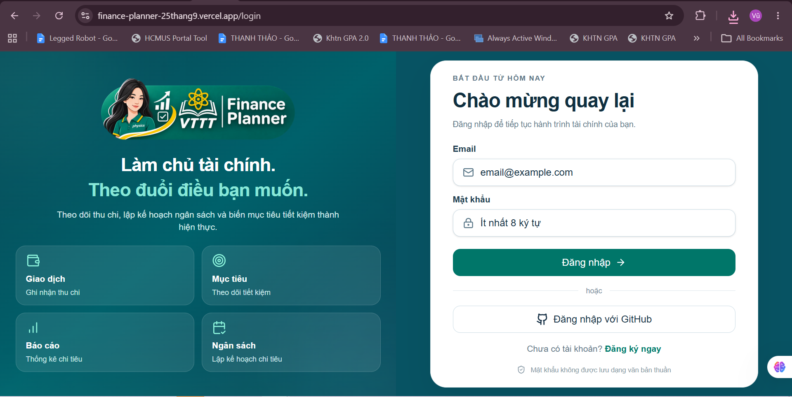

<!-- Ảnh 02: Giao diện đăng ký. Tên tệp: docs/images/register.png -->
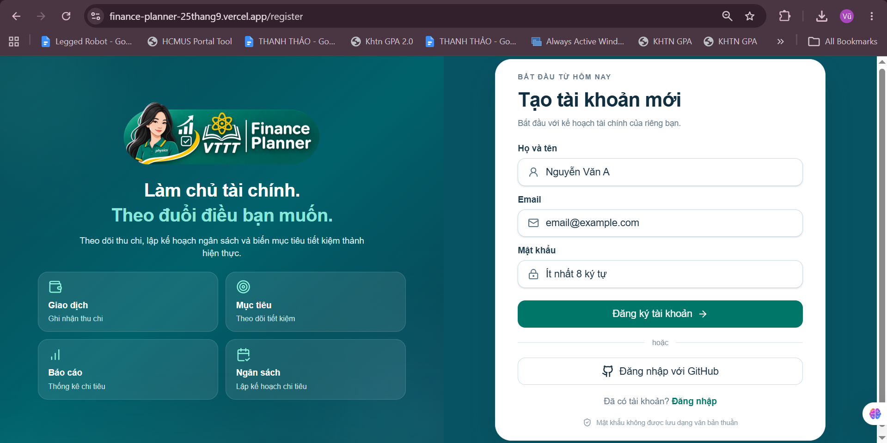

### 5.2. Dashboard và biểu đồ

<!-- Ảnh 03: Dashboard; số dư, tổng thu, tổng chi, biểu đồ. Tên tệp đã dùng trong nhật ký: docs/images/dashboard-local.png -->


### 5.3. Giao dịch và lọc theo URL

<!-- Ảnh 04: Danh sách giao dịch. Tên tệp đã dùng trong nhật ký: docs/images/transactions-local.png -->


<!-- Ảnh 05: Bộ lọc theo thời gian, danh mục và loại; ảnh thể hiện URL trên thanh địa chỉ. Tên tệp: docs/images/transaction-filters.png -->
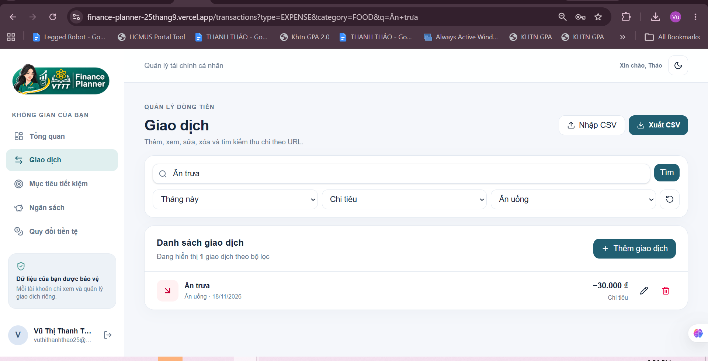

<!-- Ảnh 06: Biểu mẫu thêm hoặc sửa giao dịch, có thể chụp trạng thái thông báo thành công. Tên tệp: docs/images/transaction-form.png -->
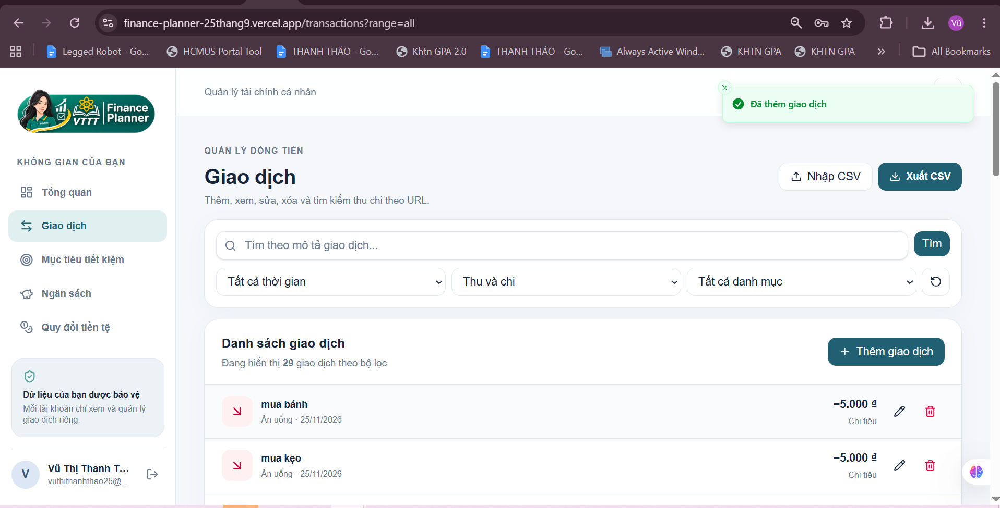

### 5.4. Mục tiêu tiết kiệm

<!-- Ảnh 07: Wishlist, tiến độ, hạn chót và gợi ý tiết kiệm mỗi tháng. Tên tệp: docs/images/wishlist-deadline.png -->
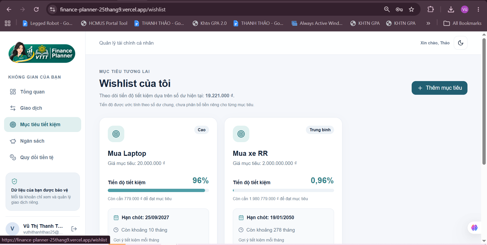

<!-- Ảnh 08: Toast chúc mừng mốc tiết kiệm 50%, 75% hoặc 100%; chỉ chèn nếu đã chụp được trường hợp thực tế. Tên tệp: docs/images/savings-milestone.png -->
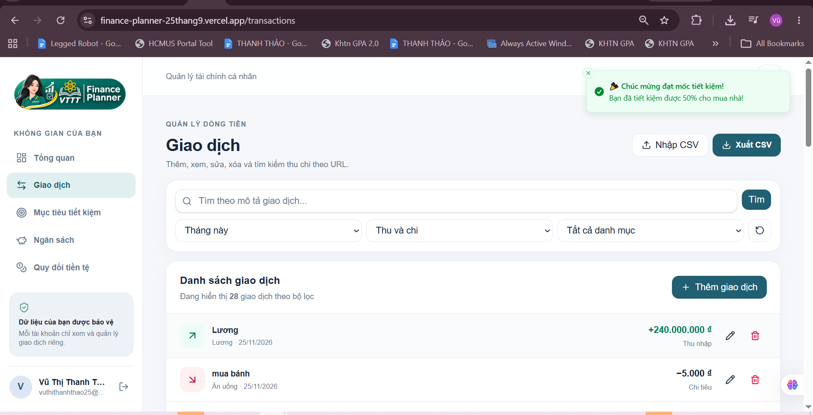

### 5.5. Ngân sách và nhập/xuất CSV

<!-- Ảnh 09: Thiết lập ngân sách, mức sử dụng và cảnh báo. Tên tệp: docs/images/budgets.png -->
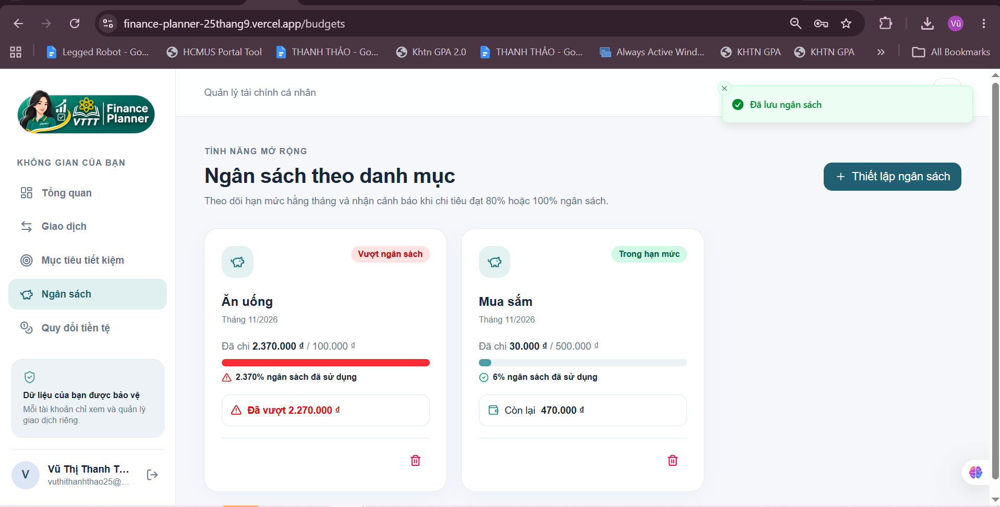

<!-- Ảnh 10: Các thao tác nhập CSV, tải file mẫu hoặc xuất CSV. Tên tệp: docs/images/csv-import-export.png -->
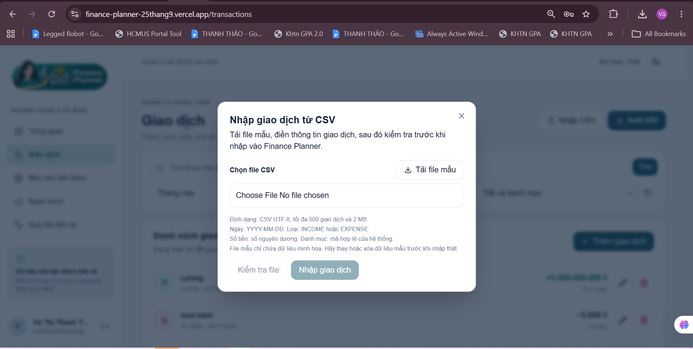

### 5.6. Quy đổi ngoại tệ

<!-- Ảnh 11: Quy đổi USD sang VND, có nguồn và thời điểm cập nhật. Tên tệp: docs/images/currency-usd.png -->
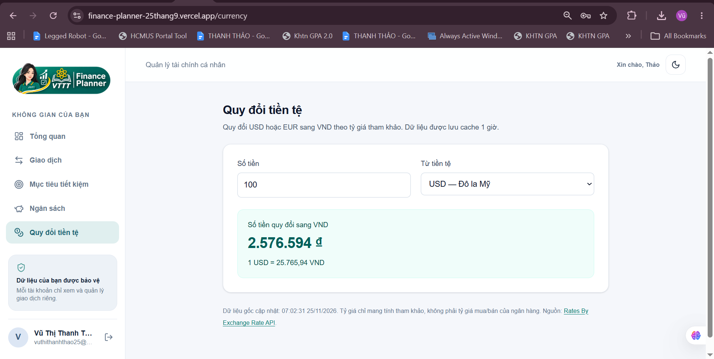

<!-- Ảnh 12: Quy đổi EUR sang VND, có nguồn và thời điểm cập nhật. Tên tệp: docs/images/currency-eur.png -->
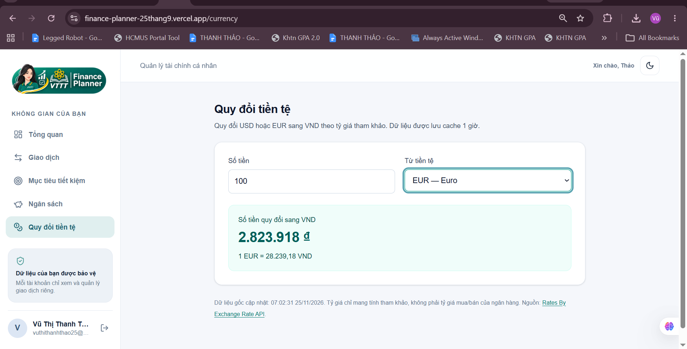

### 5.7. Chế độ giao diện và kết quả triển khai

<!-- Ảnh 13: Chế độ tối hoặc giao diện trên màn hình điện thoại. Tên tệp: docs/images/responsive-dark-mode.png -->
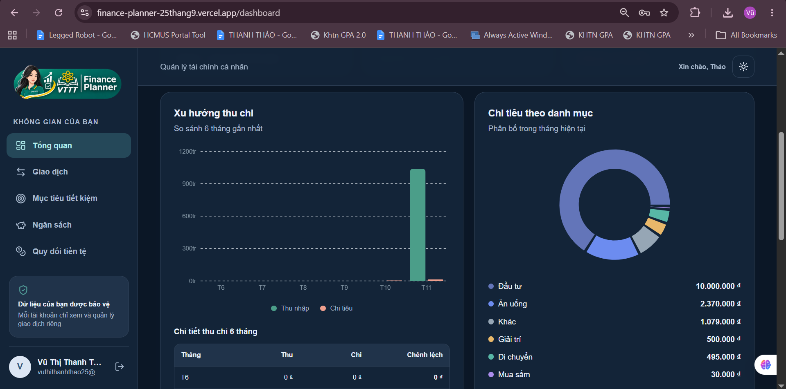

<!-- Ảnh 14: Kiểm thử GitHub Actions của commit cuối, khi CI đã đạt. Tên tệp: docs/images/github-actions-ci.png -->
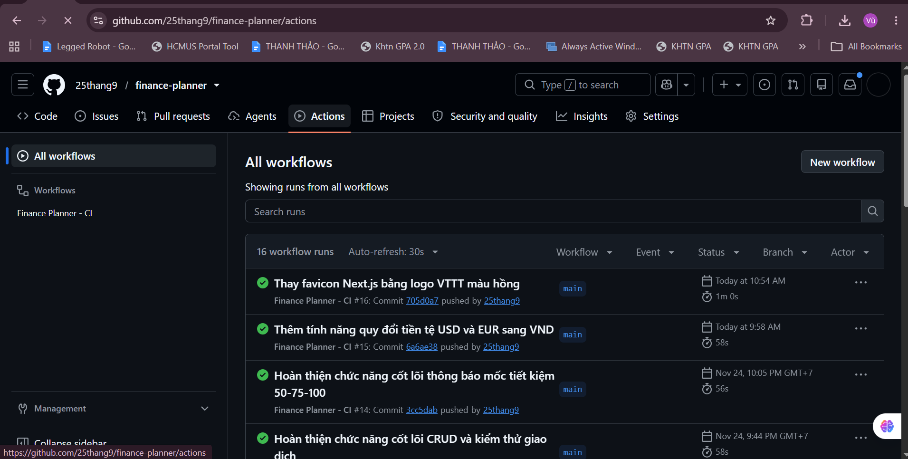

<!-- Ảnh 15: Website được truy cập qua địa chỉ Vercel Production. Tên tệp: docs/images/vercel-production.png -->
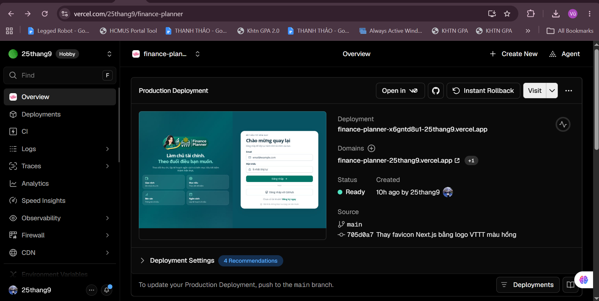

## 6. Hướng dẫn cài đặt và chạy local

### 6.1. Yêu cầu môi trường

- Node.js **24** và npm.
- PostgreSQL trên **Neon**.
- Git và trình soạn thảo mã nguồn.
- Cấu hình biến môi trường theo `.env.example`.

### 6.2. Cài đặt

```powershell
git clone https://github.com/25thang9/finance-planner.git
cd finance-planner
npm.cmd ci
Copy-Item .env.example .env
```

Các biến cấu hình chính:

| Biến | Mục đích |
|---|---|
| `DATABASE_URL` | Chuỗi kết nối Neon qua pooler |
| `DATABASE_URL_UNPOOLED` | Chuỗi kết nối trực tiếp cho Prisma/migration |
| `BETTER_AUTH_SECRET` | Khóa bí mật phiên xác thực |
| `BETTER_AUTH_URL` | URL của ứng dụng; khi chạy local là `http://localhost:3000` |
| `GITHUB_CLIENT_ID` | ID ứng dụng GitHub OAuth, nếu sử dụng |
| `GITHUB_CLIENT_SECRET` | Bí mật GitHub OAuth, nếu sử dụng |
| `DEMO_EMAIL` / `DEMO_PASSWORD` | Cấu hình tạo tài khoản mẫu khi seed, nếu cần |

Các giá trị thật chỉ lưu trong `.env` ở local hoặc mục Environment Variables của Vercel; không commit file `.env` và không đặt secret trong biến `NEXT_PUBLIC_*`.

### 6.3. Khởi tạo cơ sở dữ liệu phát triển

```powershell
npx.cmd prisma generate
npx.cmd prisma migrate dev
npx.cmd prisma db seed
```

Tệp seed có **30 giao dịch mẫu** (15 giao dịch tháng trước và 15 giao dịch tháng hiện tại) cùng ba mục tiêu tiết kiệm. Nếu tài khoản demo đã có giao dịch hoặc wishlist, mã seed hiện tại không xóa dữ liệu cũ để tạo lại. Các thao tác migration và seed cần thực hiện trên cơ sở dữ liệu phát triển phù hợp, không áp dụng tùy tiện vào dữ liệu Production.

### 6.4. Khởi chạy

```powershell
npm.cmd run dev
```

Địa chỉ chạy local: **http://localhost:3000**.

## 7. Kiểm thử và tích hợp liên tục

### 7.1. Các lệnh kiểm tra

```powershell
npm.cmd run lint
npm.cmd run typecheck
npm.cmd run test -- --run
npm.cmd run build
```

Lệnh kiểm thử E2E của Playwright, nếu được bổ sung về sau: `npx.cmd playwright test`. Phiên bản hiện tại chưa thiết lập bộ kiểm thử E2E.

### 7.2. Kết quả ghi nhận

**Ngày 25/11/2026, trên môi trường local:**

| Tệp kiểm thử | Số bài | Kết quả |
|---|---:|---|
| `finance.test.ts` | 16 | Đạt |
| `validation.test.ts` | 9 | Đạt |
| `csv-import.test.ts` | 13 | Đạt |
| `milestones.test.ts` | 12 | Đạt |
| `transaction-requirements.test.ts` | 11 | Đạt |
| `savings-plan.test.ts` | 8 | Đạt |
| `budget-insights.test.ts` | 8 | Đạt |
| `exchange-rate.test.ts` | 8 | Đạt |
| `empty-state.test.tsx` | 1 | Đạt |
| **Tổng** | **86** | **86/86 đạt** |

Kết quả kiểm tra ngày **25/11/2026**: **86/86 bài kiểm thử đạt** trên 9 tệp, gồm 85 bài kiểm thử logic/validation và 1 component test. Sau khi sửa biểu mẫu Wishlist, `npm run lint` đạt **0 lỗi, 0 cảnh báo**; `npm run typecheck` và `npm run build` đều hoàn tất thành công.

### 7.3. GitHub Actions CI

Quy trình CI tại `.github/workflows/ci.yml` được cấu hình chạy trên các sự kiện `push` và `pull_request` đối với nhánh `main`. Các bước gồm cài đặt phụ thuộc, sinh Prisma Client, lint, kiểm tra TypeScript, Vitest và build. Các lượt CI từ commit `7a806a8` đến commit bổ sung quy đổi ngoại tệ `6a6ae38` đều hiển thị thành công trên [GitHub Actions](https://github.com/25thang9/finance-planner/actions). Workflow tiếp tục được kích hoạt khi có commit mới được push lên `main`.

### 7.4. Kiểm thử bảo mật và khả năng truy cập

- `GET /api/transactions` khi không có phiên đăng nhập trả mã **401**.
- Các thao tác với dữ liệu cá nhân sử dụng thông tin người dùng từ phiên đăng nhập, không lấy quyền sở hữu dữ liệu từ `userId` do phía client tự cung cấp.
- Dữ liệu đầu vào được kiểm tra tại server; không đưa thông tin kết nối Neon hoặc khóa xác thực vào mã nguồn công khai.
- Biểu đồ chi tiêu có bảng số liệu thay thế; các điều khiển nhập liệu được gắn nhãn, hiển thị focus và hỗ trợ chế độ sáng/tối. Khi kiểm tra giao diện, các thao tác điều hướng và kích hoạt nút được thực hiện bằng `Tab`, `Shift + Tab`, `Enter`/`Space`. Đây là kiểm tra accessibility cơ bản, không phải chứng nhận đạt toàn bộ WCAG.

## 8. Quyết định kỹ thuật

| Quyết định | Lý do và đánh đổi |
|---|---|
| Sử dụng Next.js App Router và Server Actions | Hợp nhất giao diện và xử lý phía server trong cùng dự án; cần chú ý ranh giới Server/Client Components |
| Dùng Prisma ORM với Neon | Có schema và migration rõ ràng, thuận tiện cho dữ liệu quan hệ; phụ thuộc kết nối cơ sở dữ liệu ngoài |
| Lưu VND bằng số nguyên | Tránh sai lệch số thập phân với tiền VND; không dùng trực tiếp giá trị tiền ngoại tệ làm dữ liệu giao dịch VND |
| Xác thực bằng Better Auth | Quản lý session và tài khoản; GitHub OAuth phụ thuộc cấu hình ứng dụng OAuth trên môi trường triển khai |
| Validate bằng Zod phía server | Giảm nguy cơ dữ liệu không hợp lệ được ghi vào cơ sở dữ liệu |
| Lưu trạng thái lọc trên URL | Giữ bộ lọc khi tải lại trang, thuận tiện kiểm thử và chia sẻ đường dẫn |
| Tách logic nghiệp vụ thành hàm riêng | Có thể kiểm thử độc lập công thức tài chính, CSV, mốc tiết kiệm và tỷ giá |
| Cache dữ liệu tỷ giá một giờ | Hạn chế gọi lặp API ngoài; tỷ giá hiển thị có thể trễ hơn nguồn theo chu kỳ cache |

## 9. Giới hạn và hướng phát triển

- Tỷ giá USD/EUR là dữ liệu tham khảo, không phải tỷ giá giao dịch ngân hàng. Ứng dụng phụ thuộc tình trạng hoạt động và lịch cập nhật của API ngoài.
- Tỷ giá được lưu cache trong một giờ nên giá trị hiển thị có thể khác thời điểm thực tế trên các dịch vụ tỷ giá khác; dữ liệu từ nhà cung cấp được cập nhật theo lịch riêng.
- Phần tiền tiết kiệm chưa được phân bổ thành các quỹ riêng cho từng mục tiêu; tiến độ hiện dựa trên số dư tổng.
- Nhập cùng một tệp CSV nhiều lần chưa có cơ chế nhận diện tất cả giao dịch trùng lặp.
- Chưa triển khai kiểm thử E2E với Playwright; đây là phần khuyến khích cho đồ án cá nhân.
- Thông báo mốc tiết kiệm đang hiển thị trong ứng dụng; chưa hỗ trợ email và push notification.
- Endpoint tỷ giá chỉ cung cấp dữ liệu tỷ giá công khai từ nguồn ngoài, không đọc hoặc ghi dữ liệu tài chính cá nhân. Các endpoint xử lý dữ liệu người dùng có kiểm tra phiên đăng nhập và quyền sở hữu.

Hướng phát triển có thể bao gồm giao dịch định kỳ, phát hiện bản ghi CSV trùng, kiểm thử E2E và phân bổ ngân sách tiết kiệm theo từng mục tiêu. Các nội dung này **chưa được tính là chức năng đã hoàn thành**.

## 10. Tiến độ phát triển và Git tag

Các mốc theo đề bài: `fp1` (Tuần 8), `fp2` (Tuần 9), `fp3` (Tuần 10), `v1.0` (bản cuối Tuần 11).

| Git tag | Chức năng tương ứng | Trạng thái tính đến 25/11/2026 |
|---|---|---|
| [`fp1`](https://github.com/25thang9/finance-planner/tree/fp1) | Prisma schema, migration, seed 30 giao dịch, Dashboard kết nối Neon | ✅ Đã tạo bổ sung; commit `7a806a8` |
| [`fp2`](https://github.com/25thang9/finance-planner/tree/fp2) | CRUD, Zod, lọc URL và kiểm thử | ✅ Đã tạo bổ sung; commit `7a806a8` |
| [`fp3`](https://github.com/25thang9/finance-planner/tree/fp3) | Better Auth, phân quyền dữ liệu theo `userId` | ✅ Đã tạo bổ sung; commit `7a806a8` |
| `v1.0` | Phiên bản nộp cuối gồm chức năng hoàn chỉnh, CI, README, AI_LOG, AGENTS và minh chứng | Gắn trên commit hoàn thiện hồ sơ nộp bài |

Ba tag `fp1`, `fp2`, `fp3` được tạo và đẩy bổ sung lên GitHub **ngày 25/11/2026**. Cả ba cùng trỏ đến commit tích hợp `7a806a8` ngày 18/11 vì mã nguồn ban đầu được đưa lên GitHub trong một commit lớn. Việc gắn bổ sung này nhằm đánh dấu nội dung phiên bản và **không được trình bày là đã tạo đúng hạn ở ba tuần riêng biệt**. Tag `v1.0` được gắn sau khi hoàn thiện nội dung nộp cuối.

## 11. Sử dụng AI và nguồn tham khảo

Đề PHY10615 quy định **Mức 3 – AI cộng tác** cho đồ án cá nhân. Trong quá trình thực hiện Finance Planner, **mức độ sử dụng AI thực tế được tự khai báo là tương đương Mức 4 – AI toàn phần có kiểm soát**: ChatGPT hỗ trợ tạo và chỉnh sửa nhiều phần mã nguồn, phát triển chức năng, viết kiểm thử, phân tích lỗi, điều chỉnh giao diện và soạn tài liệu. Đây là khai báo trung thực về mức hỗ trợ thực tế, không phải khẳng định đã thay đổi mức AI mà đề quy định.

Các phần có AI hỗ trợ, cách sử dụng kết quả và những lần kiểm chứng/sửa lỗi được liệt kê theo ngày và commit trong [AI_LOG.md](./AI_LOG.md). Quá trình kiểm chứng bao gồm thao tác ứng dụng, TypeScript, ESLint, Vitest và production build; kết quả kiểm thử gần nhất được nêu ở Mục 7.

Một vấn đề đã được ghi nhận là bản chỉnh sửa do AI đề xuất từng làm mất khai báo `deadline` trong kiểu dữ liệu wishlist. Lỗi được phát hiện bằng kiểm tra TypeScript, sau đó được chỉnh sửa và kiểm tra lại để khôi phục build thành công.

**Tài liệu liên quan:**

- Đề bài đồ án *Phát triển ứng dụng web – PHY10615*, HK1 2026–2027.
- [WebLab – tài liệu thực hành](https://weblab.koomaru.com/).
- [Next.js](https://nextjs.org/docs), [Prisma](https://www.prisma.io/docs), [Better Auth](https://www.better-auth.com/docs), [Vitest](https://vitest.dev/).
- [ExchangeRate-API](https://www.exchangerate-api.com/).
- [Nhật ký sử dụng AI](./AI_LOG.md) và [Quy tắc dự án](./AGENTS.md).

---

**Finance Planner · PHY10615 · HK1, năm học 2026–2027**
